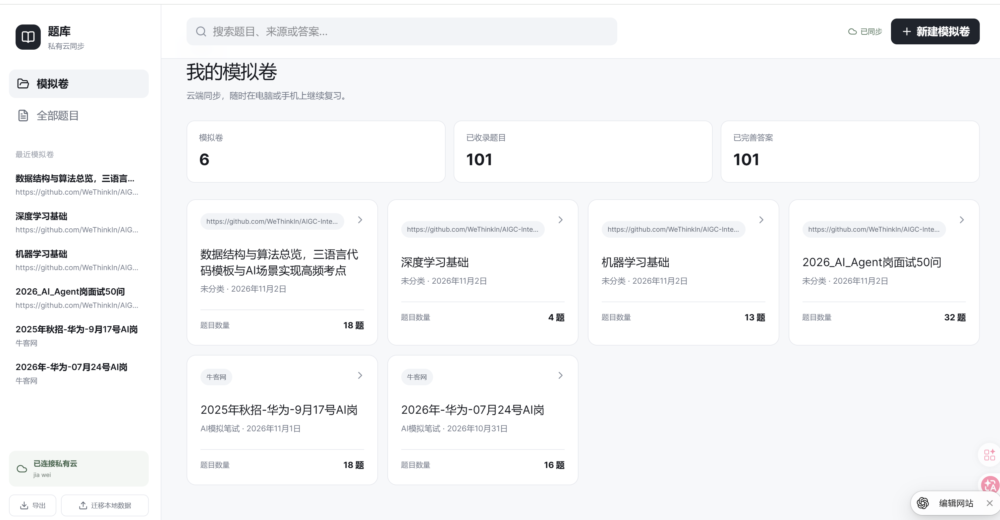
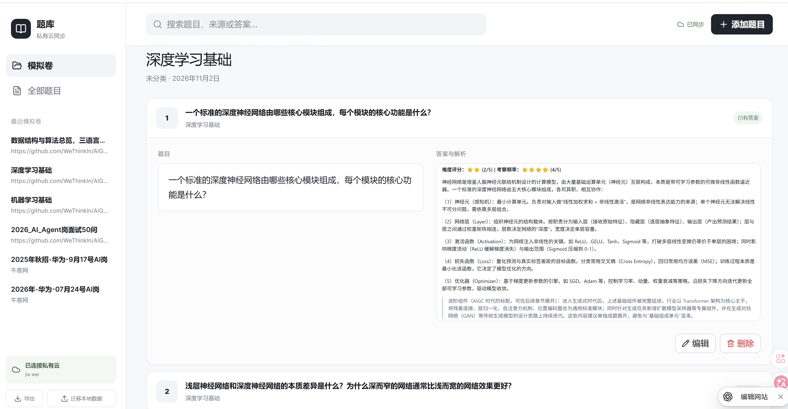

# Question Vault / 题库知识库

一个支持模拟卷、题目、答案、截图、标签与备注管理的个人题库。题目和答案采用单一图文编辑框，可像聊天软件一样在光标位置输入文字或粘贴图片。

## 界面预览

简洁的白色界面，集中管理模拟卷，并在电脑或手机上随时复习题目与答案。

### 模拟卷总览



### 题目与答案复习



## 推荐使用云版本

**优先推荐云版本。** 云版本支持电脑与手机访问、账号隔离、跨设备同步、私有数据库以及云端图片存储，适合作为长期使用的主版本。

本地版本无需 Node.js 依赖，数据保存在浏览器 IndexedDB 中，适合离线使用、快速体验或作为备用方案。清理浏览器数据前必须先导出 JSON 备份。

| 版本 | 适合场景 | 数据位置 |
| --- | --- | --- |
| 云版本（推荐） | 日常使用、手机复习、跨设备同步 | D1 数据库 + R2 图片存储 |
| 本地版本 | 离线使用、快速体验、备用 | 当前浏览器 IndexedDB |

## 功能

- 按来源、科目、考试日期管理模拟卷
- 题目与答案均使用单一图文编辑框
- 在光标位置直接粘贴截图，支持多图片与文字混排
- 标签与备注独立管理
- 跨模拟卷搜索与移动端响应式界面
- JSON 整库导出、导入与本地数据迁移
- 云端按登录用户隔离数据

## 本地版本

### Windows

双击 `启动题库.cmd`，浏览器会打开 <http://127.0.0.1:5000/>。

### 手动启动

```powershell
python -m http.server 5000 --bind 127.0.0.1
```

不要直接双击 `index.html`，部分浏览器会限制 `file://` 页面使用本地数据库。

## 云版本（推荐）

云版本源码位于 [`cloud/`](cloud/)，技术栈为 React、Vinext、Cloudflare Workers、D1、R2 与 Drizzle ORM，并使用 ChatGPT Sites 提供的登录身份。

### 本地开发

要求 Node.js `>=22.13.0`。

```powershell
cd cloud
Copy-Item .openai/hosting.example.json .openai/hosting.json
npm ci
npm run dev
```

本地开发环境会使用模拟登录身份。云端部署前，请通过 ChatGPT Sites 创建自己的站点，并将生成的项目 ID 写入未跟踪的 `.openai/hosting.json`。不要提交真实站点标识、环境变量或密钥。

数据库结构位于 `cloud/db/schema.ts`，迁移文件位于 `cloud/drizzle/`：

```powershell
npm run db:generate
```

## 项目结构

```text
question-vault/
├─ index.html            # 本地版入口
├─ app.js                # 本地版业务逻辑
├─ styles.css            # 本地版样式
├─ 启动题库.cmd          # Windows 本地启动脚本
└─ cloud/                # 私有云同步版
   ├─ app/               # 页面与 API
   ├─ db/                # 数据库结构
   ├─ drizzle/           # D1 迁移
   └─ worker/            # Worker 入口
```

## 数据与隐私

- 仓库不包含任何用户题库数据。
- 本地题库数据只存在浏览器 IndexedDB 中。
- 云端数据按登录用户 ID 隔离。
- `.env*`、本地数据库状态、构建产物和真实 Sites 配置均已加入忽略规则。
- 建议定期使用应用内“导出”功能保留 JSON 备份。

## 参与贡献

欢迎提交 Issue 和 Pull Request。开始前请阅读 [CONTRIBUTING.md](CONTRIBUTING.md)。

## License

[MIT](LICENSE)
